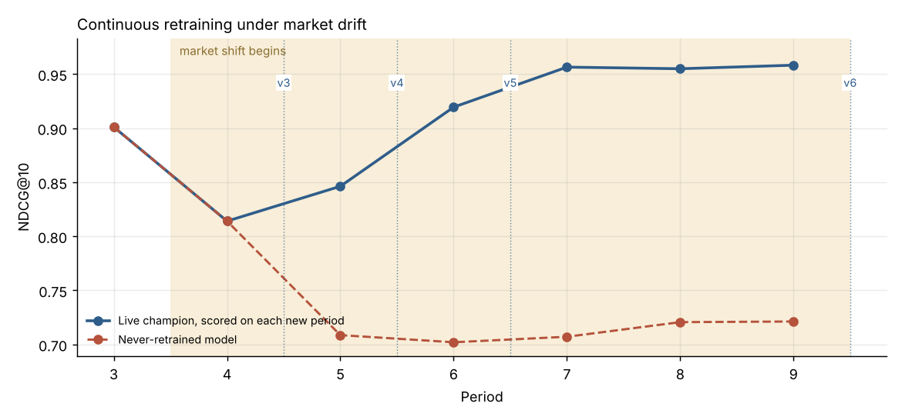
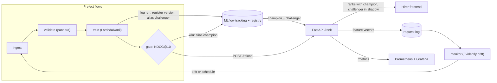

# hirer-rankops

A candidate-ranking model that keeps itself current. It is a learning-to-rank model (LightGBM LambdaRank) behind a FastAPI service, inside a closed MLOps loop:

**ingest → validate → train → champion/challenger gate → serve (+ shadow) → log → drift check → retrain**

Hiring markets move. When GenAI skills became hot, a ranker trained on last year's recruiter decisions kept ranking candidates the old way. This repo simulates that kind of shift and shows the pipeline notice it, retrain, prove the new model is better, and swap it in with no downtime.



*The red line is a model that was never retrained: its NDCG@10 falls from 0.90 to about 0.71 after the market shifts. The live champion recovers to about 0.96 through three drift-triggered promotions (v3 → v4 → v5). The dotted lines show when each new model starts serving.*

## Results from `make simulate`

| Period | Live model | Live NDCG@10 | Frozen model | Drift share | Action |
|---|---|---|---|---|---|
| 3 | v1 | 0.901 | 0.901 | 0.00 | Scheduled retrain. **Rejected**: gain +0.0013 < 0.005 |
| 4 | v1 | 0.814 | 0.814 | 0.57 | Drift detected. **Promoted v3** (+0.046) |
| 5 | v3 | 0.846 | 0.709 | 0.71 | Drift detected. **Promoted v4** (+0.085) |
| 6 | v4 | 0.919 | 0.702 | 0.57 | Drift detected. **Promoted v5** (+0.031) |
| 7 | v5 | 0.956 | 0.707 | 0.29 | No action |
| 8 | v5 | 0.955 | 0.721 | 0.14 | No action |
| 9 | v5 | 0.958 | 0.721 | 0.36 | Drift detected. **Promoted v6** (+0.0095) |

Period 3 is the gate doing its job: retraining on stable data gave a model that was only noise-level better, so production stayed unchanged. Version 2 is that rejected challenger, still in the registry with the reason recorded.

## Architecture



| Stage | Tool | Why |
|---|---|---|
| Data contracts | Pandera | A bad batch fails loudly before it trains anything. Includes cross-table and "is this ranking query informative" checks |
| Data versioning | DVC (`dvc.yaml`) | `dvc repro` rebuilds the current model from `params.yaml` |
| Model | LightGBM `LGBMRanker`, `lambdarank` | Optimises NDCG directly, trains in seconds on CPU |
| Tracking + registry | MLflow 3 | Every run logs params, metrics, feature importance, a data fingerprint and its drift baseline. Versions move between the `challenger`, `champion` and `previous_champion` aliases |
| Promotion | `rankops/promote.py` | Champion and challenger are scored on the *same* held-out jobs from the newest period. The challenger must win NDCG@10 by ≥ 0.005 without losing > 0.01 NDCG@5 |
| Serving | FastAPI | Hot reload through `/reload`, so no restart. A rejected challenger keeps running in **shadow** mode, and its top-10 agreement with the champion is exported |
| Monitoring | Evidently + Prometheus/Grafana | Feature drift on logged traffic, plus latency, throughput, model version and shadow agreement |
| Orchestration | Prefect 3 | Retries, a cron schedule (daily 02:00 IST), and drift-triggered retraining |
| CI/CD | GitHub Actions | Lint and tests, then the **full drift simulation as a regression test** (CI fails if retraining stops beating the frozen model), then the image is pushed to GHCR |

## Quick start (EndeavourOS)

```bash
cd ~/Documents/github
git clone git@github.com:Sidvortex/hirer-rankops.git && cd hirer-rankops
make install          # pip install --break-system-packages -r requirements.txt
make test             # 18 tests, ~15 s
make simulate         # the whole story above, ~1.5 min on CPU
make mlflow-ui        # http://localhost:5000: runs, versions, aliases, promotion tags
```

Open `reports/drift_p4.html` for Evidently's per-feature drift report from the moment the shift was caught.

### Run it as a live system

```bash
make data PERIOD=2 && make retrain PERIOD=2   # first champion
make serve                                    # API on :8000 (docs at /docs)
make replay PERIOD=2                          # send traffic
python -m rankops.data 3 4 && make replay PERIOD=4
make monitor PERIOD=4                         # drift → retrain → gate
curl -X POST localhost:8000/reload            # or set RANKOPS_SERVING_URL and the flow does it
make rollback                                 # if a promotion goes wrong
```

### Docker stack

```bash
sudo pacman -S --needed docker docker-compose docker-buildx
sudo systemctl enable --now docker && sudo usermod -aG docker $USER   # then log out and back in

make up          # MLflow :5000, API :8000, Prometheus :9090, Grafana :3000
make bootstrap   # generate data, train and promote the first model
make up-jobs     # scheduled Prefect monitor/retrain worker
```

Grafana opens with the "Hirer ranker — serving" dashboard already provisioned.

## API

```bash
curl -s localhost:8000/rank -H 'content-type: application/json' -d '{
  "job": {"job_id": "j1", "required_skills": ["python","fastapi","docker"],
          "min_experience": 2, "location": "noida", "remote": false, "salary_max_lpa": 18},
  "candidates": [
    {"candidate_id": "a", "skills": ["python","fastapi","llm"], "years_experience": 3,
     "location": "noida", "education": "bachelors", "expected_salary_lpa": 14},
    {"candidate_id": "b", "skills": ["react"], "years_experience": 6,
     "location": "pune", "education": "masters", "expected_salary_lpa": 25}
  ],
  "top_k": 10}'
```

Endpoints: `POST /rank`, `POST /reload`, `GET /health`, `GET /metrics`, and interactive docs at `/docs`.

## Plugging in real Hirer data

`rankops/data.py` is the only simulated piece. Write real batches as `data/raw/period_N/{jobs,candidates,applications}.parquet` using the columns in `rankops/validate.py`, and point the `ingest` task in `flows/pipeline.py` at Hirer's database. Use recruiter actions as relevance grades, for example 0 rejected, 1 viewed, 2 shortlisted, 3 interviewed, 4 hired. Everything downstream stays the same.

## Design decisions worth defending

- **One feature function for training and serving.** `pair_features` builds both. `test_no_training_serving_skew` checks that an API payload produces exactly the training features for the same pair.
- **Evaluate on the newest data.** The holdout comes from the newest period only. A model that looks good on last quarter's data but is wrong about this quarter's is exactly what the gate should block.
- **Drift triggers retraining; NDCG decides promotion.** Input drift is the earliest signal, because in hiring the labels arrive weeks later. Drift alone never changes production, though. Only the gate does.
- **Shadow before promote.** A challenger that loses the gate keeps scoring live traffic in the background. A sudden drop in top-10 overlap is a cheap early warning.
- **Auditable decisions.** Every registry version carries `promotion_decision` and `promotion_reason` tags, plus a JSON record in `reports/`.
- **Limitation:** the simulation assumes labels for a period are available when that period is evaluated. In a real deployment, you would add a label-delay window and run the gate on the latest *labelled* period.

## Layout

```
rankops/
  data.py        synthetic periods + market shift (swap for real ingest)
  validate.py    pandera data contracts
  features.py    shared training/serving features
  train.py       LambdaRank + MLflow logging/registration
  promote.py     champion/challenger gate, rollback
  serve.py       FastAPI, shadow scoring, request log, Prometheus
  monitor.py     Evidently drift check on logged traffic
  replay.py      replay a period as API traffic
flows/pipeline.py   Prefect retrain + monitor flows, cron schedule
scripts/simulate.py end-to-end drift demo → reports/timeline.{csv,png}
monitoring/         Prometheus scrape config, Grafana datasource + dashboard
tests/              unit + integration (temp MLflow registry)
```